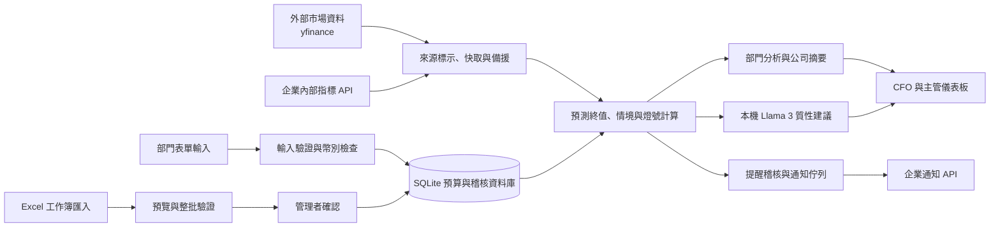

# 智衡預算雷達｜提案摘要與企劃書

## 提案摘要

| 項目             | 內容                                                                                                                                                                                |
| ---------------- | ----------------------------------------------------------------------------------------------------------------------------------------------------------------------------------- |
| 團隊名稱         | **剛好遇見你**                                                                                                                                                                |
| 團員姓名與學校   | **廖若羽、徐羽喬、鄭年芮** ｜ **國立政治大學**                                                                                                                          |
| 選擇題目         | **6-1 預算預測與差異分析助手**（Budget Forecasting & Variance Analysis Assistant）                                                                                            |
| 產品／服務名稱   | **智衡預算雷達**（IntelliBalance Budget Radar）                                                                                                                               |
| 服務對象         | 保險公司財務管理者、部門主管、預算編列與執行人員；導入時亦包含精算、投資、核保理賠及內控等資料責任單位。                                                                            |
| 核心問題         | 預算、實際支出、剩餘期間預測與市場變化分散在部門資料及試算表中；主管難以及早看見可能超支、執行落後、匯率風險或歷史資料缺漏。                                                        |
| 解決方案設計重點 | 1. 整合外部市場指標與內部營運數據，自動化計算匯率與通膨風險曝險。2. 設立四級動態預警燈號，精準鎖定預算超支與進度落後盲區。3. 導入 LLM 生成質性財務管理建議，輔助 CFO 制定調控決策。 |
| 使用技術         | Python、Flask、SQLite、Pandas、yfinance、Schedule、Ollama／Llama 3 本地化部署；REST API 介接企業內部指標。                                                                          |
| 預期效益         | 縮短財務報表產出與覆核時間、降低匯率/通膨帶來的預算超支風險、打破部門穀倉效應，提升高階主管決策效率。                                                                               |

---

## 01. 提案概述

### 企業挑戰題目與核心問題

本提案選擇「6-1 預算預測與差異分析助手」。傳統壽險業的預算編列多為年度靜態規劃，但營運高度受總體經濟（匯率波動、通貨膨脹）與業務變動（理賠頻率、金融震盪）影響。
當前痛點在於：財務部門難以即時估算外部變數對「剩餘預算」的真實衝擊。單看實際支出與年度預算比例，預警往往落後，超支與進度落後常在月結後才被發現，且歷史資料缺漏若無明確標示，會使比較失去可靠基礎。

### 服務對象與需求

* **CFO／財務長**：需要掌握全公司的預算執行率、資金超支風險，並獲得 AI 彙整的跨部門質性管理建議。
* **各部門主管（投資、風險、業務、核保理賠、後勤）**：需要專屬的風險監控指標，並以直覺的燈號了解本部門預算健康度與調整方向。
* **預算與資料管理人員**：需要 Excel 批次匯入、欄位驗證、錯誤預覽與可追溯的確認流程。

### 價值主張

智衡預算雷達把「已花多少」延伸為「依目前執行與情境，期末可能花多少」。透過整合市場參數校正預期支出，提早反映資金缺口。系統使用確定性公式計算金額與燈號，AI 僅負責補充質性建議；主管可回到科目核對原始輸入，保留絕對的人工決策權。

---

## 02. 解決方案與架構說明

### 整體系統架構與資料流程

### 預測終值運算邏輯 (A + Fx + D)

為解決靜態預算的盲點，所有原幣別金額最終統一轉換為 TWD（報表幣）以進行加總，核心運算公式為：

$$
\text{預測終值} = A + F_x + D
$$

（$A$：實際支出、$F_x$：經市場情境調整預測、$D$：新增需求）
其中，$A$ 與 $D$ 若為 USD 則乘上當下「市場即期匯率」。$F_x$ 則以使用者輸入的「基準預測 $F_0$」為基礎，進行兩階段精細調整：

**階段一：通膨與物價指數傳導 (Index Transmission)**

* **內控與後勤部門**（行政耗材、軟硬體維護）：
  $$
  F_{idx} = F_0 \times \left(1 + \left(\frac{\text{市場 CPI}}{\text{基準 CPI}} - 1\right) \times \beta\right)
  $$
* **核保與理賠部門**（公證外包）：
  $$
  F_{idx} = F_0 \times \left(1 + \left(\frac{\text{市場醫療指數}}{\text{基準醫療指數}} - 1\right) \times \beta\right)
  $$
* *其他部門（投資、風險、業務）不作此階段指數調整，維持原 $F_0$ 金額。*

**階段二：匯率曝險與避險部位拆分 (Currency & Hedging)**

* 若科目為 TWD：直接維持上階段結果（不產生匯率曝險）。
* 若科目為 USD：依照「避險鎖定比例 $h$」拆分匯率風險。
  $$
  F_x = F_{idx} \times \left[ h \times FX_{budget} + (1 - h) \times FX_{spot} \right]
  $$

### 燈號系統與各部門風險指標

系統依據計算結果與即時數據，自動觸發以下燈號與專屬警報：

* **四級預算健康燈號**：
  * 🔴 **紅燈**：未編預算或超支 $\ge 10\%$
  * 🟡 **黃燈**：溫和超支
  * 🔵 **藍燈**：進度落後（排程項目未執行額達同期預算 $10\%$）
  * 🟢 **綠燈**：安全無虞
* **部門專屬風險指標觸發門檻**：
  * **投資管理部門**：監控避險成本偏離。當 $\left\vert \frac{\text{USD 即期匯率} - \text{USD 遠期匯率}}{\text{USD 即期匯率}} - 2\% \right\vert \ge 1.5\%$ 時觸發警示。
  * **風險管理部門**：監控整體風險與資本。當 $\text{VIX} \ge 35$ 或 $\text{RBC} < 200\%$ 時觸發警戒。
  * **業務部門**：監控業績動能。當 $\text{同業 FYP 成長} - \text{本公司 FYP 成長} \ge 5\%$ 時觸發警示。
  * **核保與理賠部門**：監控理賠頻率。當 $\text{醫療險理賠 MoM} \ge 5\%$ 時觸發警戒。

### 痛點與體驗改善對照

| 既有痛點                         | 系統改善方式                                                            |
| -------------------------------- | ----------------------------------------------------------------------- |
| 只看已發生支出，難以預測年末缺口 | 以累計實際、剩餘期間預測與新增需求（$A + F_x + D$）動態估算期末結果。 |
| 外幣支出及避險狀態需人工試算     | 允許以原幣輸入，系統按設定的報表匯率和避險比例 $h$ 自動換算為 TWD。   |
| 超支或進度落後仰賴主管自行比對   | 以一致門檻呈現四級動態燈號，要求紅燈科目強制填寫原因。                  |
| AI 摘要可能產生幻覺捏造假數字    | 報告數字 100% 由程式計算，LLM 僅提供質性建議，專注於管理洞察。          |

---

## 03. 應用技術說明

| 技術                            | 用途與選用原因                                                                                                     | 發揮作用步驟                                           |
| ------------------------------- | ------------------------------------------------------------------------------------------------------------------ | ------------------------------------------------------ |
| **Python + Flask**        | 建置部門表單、匯入、分析及管理頁，適合快速串接資料處理與 Web 流程。                                                | 使用者登入、期間切換、預算輸入、摘要與提醒。           |
| **Pandas + OpenPyXL**     | 讀取與產生 Excel 範本，執行批次資料檢查。                                                                          | Excel 上傳、欄位驗證、錯誤預覽及範本下載。             |
| **yfinance + 持久快取**   | 取得 VIX、USD/TWD 即期與美債 10 年期殖利率；快取可在短期來源故障時保留最後成功值。                                 | 市場情境更新、來源標示及有限備援。                     |
| **內部 REST API Adapter** | 依企業提供的端點取得 RBC、FYP、理賠及指數資料；避免將示範常數誤認成實績。                                          | 市場與內部營運數據匹配；未設定端點時明確標示為示範值。 |
| **Ollama + Llama 3**      | **本地端部署避免機敏資料外洩**。透過嚴格 Prompt Engineering 限制模型不計算金額，僅產出管理者可讀的質性建議。 | 報表計算完成後提供建議；協助 CFO 解讀燈號與風險警報。  |

---

## 04. 預期效益與商業潛力

### 預期效益 (量化目標)

以下為系統導入試行的建議驗證目標：

| 指標                           |                        建議試行目標 | 衡量方式                                                     |
| ------------------------------ | ----------------------------------: | ------------------------------------------------------------ |
| 月度預算彙整與差異分析工時     | 相較人工基準降低 **30% 以上** | 記錄每月彙整、核對及報告製作總工時。                         |
| 超支或進度落後的管理反應時間   |     相較現況縮短 **20% 以上** | 記錄首次異常出現至主管確認並指定處置的時間。                 |
| 可在資料匯入階段發現的格式錯誤 |       測試案例覆蓋率 **100%** | 核對缺欄、錯期間、重複代碼、錯幣別與非法比例是否被自動攔截。 |

### 質化效益與商業潛力

* **打破部門穀倉效應**：將投資部的「避險成本偏離」、風險部的「RBC/VIX」、核保部的「理賠月增率」統一整合進財務視角，實現全方位的企業營運風險控管。
* **落地條件**：無縫接軌企業現有流程，保留 Excel 匯入功能以降低人員學習成本。
* **擴大應用**：系統架構高度模組化，其「市場情境動態調整」計算邏輯不僅適用於壽險業，亦可平行移植至產險業、銀行業，或是深受原物料與匯率影響深遠的跨國製造業預算風險管理。

---

## 05. 補充資料／備註

### 資料來源與現況

| 資料                               | 系統處理方式與正式使用條件                                                                                                           |
| ---------------------------------- | ------------------------------------------------------------------------------------------------------------------------------------ |
| **VIX、USD/TWD、US 10Y**     | 由 `yfinance` 取得近期日收盤；正式上線需確認企業對來源授權與快取政策。                                                             |
| **RBC、FYP、理賠、物價指數** | 透過 `INTERNAL_MARKET_API_URL` 接入企業內部資料；未串接前系統自動套用明確標示的「示範值」（如 RBC 示範值 $245\%$）以利評審測試。 |

### 資料假設與商業邏輯依據

* **匯率政策假設**：預設 USD 鎖定部位的預算基準匯率 ($FX_{budget}$) 為 $31.0$。
* **遠期匯率估算**：採用利率平價估算模型，公式為：

  $$
  F = S \times \frac{1 + 0.01875}{1 + y\_US10Y}
  $$

  台幣年利率假設為 $0.01875$，結合美債 10 年期殖利率推算遠期匯率，專用於監控投資部門的「避險成本偏離度」。不得將模型估值當成實際可交易遠期報價。
* **限制與安全宣告**：LLM 不產生計算金額，只提供質性建議。系統 V18 已含部門角色限制與 CSRF 防護；正式對外服務仍須完善 HTTPS、密鑰管理與資安測試。
