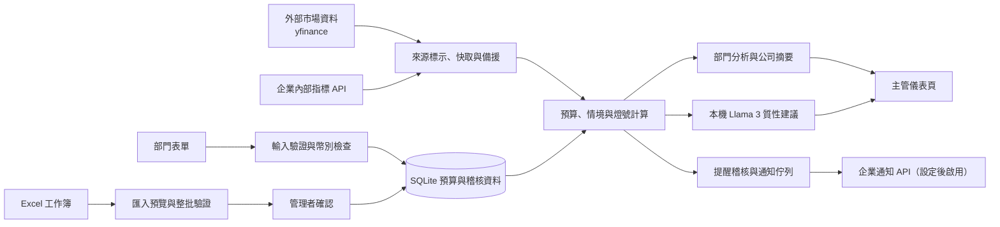

# 智衡預算雷達｜專案介紹與提案內容

> 本文件依 V18 覆蓋版程式與現有資料來源設計撰寫，供提案簡報編修使用。團隊名稱尚未提供，以「待填」標示；效益量化值是試行目標，不是已完成的實測成果。

## 提案摘要

| 項目 | 內容 |
|---|---|
| 團隊名稱 | **待填：請填正式參賽團隊名稱** |
| 選擇題目 | **6-1 預算預測與差異分析助手**（Budget Forecasting & Variance Analysis Assistant） |
| 產品／服務名稱 | **智衡預算雷達**（Budget Risk & Forecast Radar） |
| 服務對象 | 保險公司財務管理者、部門主管、預算編列與執行人員；導入時亦包含精算、投資、核保理賠及內控等資料責任單位。 |
| 核心問題 | 預算、實際支出、剩餘期間預測與市場變化分散在部門資料及試算表中；主管難以及早看見可能超支、執行落後、匯率風險或歷史資料缺漏。 |
| 解決方案設計重點 | 將多幣別預算資料集中輸入／匯入，以可追溯的公式計算 TWD 報表幣預測，套用部門及費用類別的情境調整，呈現差異燈號與資料來源狀態，並以 AI 產生質性管理建議。 |
| 使用技術 | Python、Flask、Flask-SQLAlchemy、SQLite、Pandas、OpenPyXL、yfinance、Schedule、Ollama／Llama 3；REST API 介接企業內部指標及通知服務。 |
| 預期效益 | 提早識別預算偏差，減少人工彙整與重複核對，讓主管按部門、科目、燈號與市場資料狀態安排覆核。效益目標需透過試行前後比較驗證。 |
| 成熟度說明 | V18 已提供可操作的應用骨架；正式使用仍需設定使用者、財務匯率政策、企業內部 API 與通知端點，並完成使用者驗收。 |

## 01. 提案概述

### 企業題目與核心問題

本提案選擇「6-1 預算預測與差異分析助手」。保險公司部門年度預算、期間預算、實際支出、剩餘期間預測與市場敏感費用通常分散在不同工作表或管理系統。傳統差異表主要呈現已發生的支出；主管仍需自行整理多幣別資料、估算期末支出並判斷市場因素是否改變預算風險。

當匯率、通膨、醫療成本、理賠頻率或資本指標變化時，單看實際支出與年度預算比例，可能無法及早辨識年末缺口、預算外支出或專案進度落後。歷史資料缺漏及來源時效若沒有明確標示，也會使比較與判斷失去可靠基礎。

### 服務對象與需求

- **財務管理者：**需要公司／部門彙總、差異原因、匯率及市場假設一覽，並以一致的金額口徑比較預算與預測。
- **部門主管：**需要輸入或修正執行資料、查看科目燈號及提交超支說明。
- **預算與資料管理人員：**需要 Excel 批次匯入、欄位驗證、錯誤預覽與可追溯的確認流程。
- **風險、精算、投資與核保理賠單位：**需要在關鍵指標越過門檻時收到人工覆核提示。

### 價值主張

智衡預算雷達把「已花多少」延伸為「依目前執行與情境，期末可能花多少」，並將計算值、資料來源、備援狀態及歷史資料完整度一起呈現。系統使用確定性公式計算金額與燈號，AI 負責補充文字建議；主管可回到科目和原始輸入核對，保留人工決策權。

## 02. 解決方案與架構說明

### 整體架構

### 流程設計與運作方式

1. **選定分析期間：**使用者選擇年度與 Q1–Q4 或 YTD。
2. **輸入或匯入資料：**部門直接編輯預算科目，或由管理者上傳五部門 Excel 工作簿。系統檢查年份、欄位、代碼、類別、幣別、數字、比例與排程設定；錯誤批次不可確認匯入。
3. **取得並標示情境資料：**公開市場資料以外部來源取得；企業 RBC、FYP、理賠、CPI 與醫療指標透過設定的內部 API 取得。未設定的指標明確標示為示範值或備援值。
4. **換算及計算：**原幣金額轉為 TWD 報表幣，套用適用的價格傳導及避險假設，計算基準預測、市場情境、含新增需求預測、差異率及燈號。
5. **預警與人工覆核：**系統將預算外支出、預估超支、排程落後及部門專業指標整理為提醒；管理者可查詢提醒狀態，通知端點只有設定後才實際送出。
6. **摘要及後續行動：**部門結果頁呈現科目差異、說明與資料狀態；管理者公司摘要按部門彙總，LLM 提供質性建議，數字由程式計算。

### 計算與門檻設計

- **期末預測：**`A + Fx + D`，其中 A 為累計實際、Fx 為剩餘期間市場調整後預測、D 為新增需求。
- **預算差異：**期末預測減年度預算 B；差異率為差異除以 B。B 為零且預期支出大於零時觸發紅燈。
- **燈號：**差異率達 10% 為紅燈；未達紅燈但預測超支為黃燈；未超支為綠燈；排程項目未執行額達同期預算 10% 為藍燈；缺少必要資料或同期預算時為灰燈。
- **市場情境：**支援部門指定類別及核保理賠公證外包可依價格指數比及傳導係數調整 F0。USD Fx 依避險鎖定比例拆分：鎖定部分按基準匯率，未鎖定部分按即期匯率換算。

### 痛點與體驗改善

| 既有痛點 | 系統改善方式 |
|---|---|
| 人工逐表彙整，跨部門數字不易一致 | 透過標準欄位與批次驗證集中資料，並建立公司／部門統一摘要。 |
| 只看已發生支出，難以預測年末缺口 | 以累計實際、剩餘期間預測與新增需求估算期末結果。 |
| 外幣支出及避險狀態需人工試算 | 以原幣輸入，按設定的報表匯率和避險比例換算為 TWD。 |
| 超支或進度落後仰賴主管自行比對 | 以一致門檻呈現紅黃綠藍灰燈，要求紅燈科目填寫原因。 |
| 歷史缺值容易誤當零支出 | 公司摘要區分無資料、部分缺漏與完整歷史值。 |
| AI 摘要可能生成不一致數字 | 報告數字由程式產生，LLM 僅提供質性建議；模型不可用時提供規則式備援。 |

## 03. 應用技術說明

| 技術 | 用途與選用原因 | 發揮作用步驟 |
|---|---|---|
| Python + Flask | 建置部門表單、匯入、分析及管理頁，適合快速串接資料處理與網頁流程。 | 使用者登入、期間切換、預算輸入、摘要與提醒。 |
| Flask-SQLAlchemy + SQLite | 保存預算列、使用者、匯入批次、提醒稽核及通知佇列；SQLite 適合概念驗證與單機試行。 | 預算儲存、唯一鍵防重複、匯入交易、稽核與通知狀態。 |
| Pandas + OpenPyXL | 讀取與產生 Excel 範本，執行批次資料檢查。 | Excel 上傳、欄位驗證、錯誤預覽及範本下載。 |
| 確定性財務公式 | 以明確輸入、匯率與門檻計算預測、差異及燈號，便於主管覆核。 | 幣別轉換、價格指數傳導、期末預測與異常判斷。 |
| yfinance + 排程 + 持久快取 | 取得 VIX、USD/TWD 及美國 10 年期殖利率的近期日收盤資料；快取可在短期來源故障時保留最後成功值。 | 市場情境更新、來源與時效標示及有限備援。 |
| 內部 REST API Adapter | 依企業提供的端點與 Token 取得 RBC、FYP、理賠及指數資料；避免將示範常數誤認成企業實績。 | 市場與精算資料匹配；未設定端點時明確標示示範值，不以示範值觸發專業提醒。 |
| Ollama + Llama 3 | 在本機產生管理者可讀的質性建議，避免將金額計算交給生成模型。 | 報表計算完成後提供建議；輸出出現數字或格式不符即使用固定備援文案。 |
| REST 通知端點 + Outbox | 先保存提醒事件與唯一鍵，再依管理者設定送出；可記錄已送、失敗與重試狀態。 | 風險提醒及管理者送達紀錄頁。 |
| Session 權限 + CSRF Token | 限制管理者與部門使用者可見範圍，並保護資料變更表單。 | 登入、角色控管及所有 POST 操作。 |

## 04. 預期效益與商業潛力

### 預期效益

以下為建議的**試行驗證目標**，尚非本系統已量測成果。應先記錄目前人工流程的基準，再以 1–2 個預算週期比較：

| 指標 | 建議試行目標 | 衡量方式 |
|---|---:|---|
| 月度預算彙整與差異分析工時 | 相較人工基準降低 30% 以上 | 記錄每月彙整、核對及報告製作總工時。 |
| 可在資料匯入階段發現的格式錯誤 | 測試案例覆蓋率 100% | 建立錯誤工作簿案例，核對缺欄、錯期間、重複代碼、錯幣別與非法比例是否被攔截。 |
| 部門預算列的必要欄位完整率 | 試行期達 95% 以上 | 具備預算、實際、F0、幣別及期間資料的有效科目列數／應填列數。 |
| 超支或進度落後的管理反應時間 | 相較現況縮短 20% 以上 | 記錄首次異常出現至主管確認並指定處置的時間。 |

### 質化效益

- 主管可在期末前查看預測差異，提前安排預算調整或資源重分配。
- 各部門以一致公式及幣別口徑溝通，降低人工公式與版本差異。
- 提醒與超支說明留有紀錄，便於管理覆核及後續追蹤。
- 清楚標記來源、快取、模型估算與示範資料，協助主管判斷結果可信度。
- 讓財務、精算、風險、投資、核保理賠及內控能以共同分析流程協作。

### 商業潛力與擴大應用

第一階段可在單一保險公司內部以部門預算管理試行，先接入財務匯入資料，再依優先序串接市場與內部指標 API。第二階段可擴大到投資避險成本、理賠費用、專案進度及跨年度預算情境。完成企業權限、稽核、資料治理與多租戶設計後，方案可延伸為保險業預算風險管理平台，或套用於具有多部門、多幣別支出的金融與大型企業。

商業化前提包括：企業資料授權及 API、匯率政策核定、財務系統整合、權限與稽核要求、服務維運及資安審查。現階段不宣稱已完成企業級部署或市場化驗證。

## 05. 補充資料／備註

### 資料來源與現況

| 資料 | V18 目前處理方式 | 正式使用條件 |
|---|---|---|
| VIX、USD/TWD、US 10Y | 由 yfinance 取得近期日收盤；程式不保證為盤中即時報價。 | 確認來源授權、更新時效、休市及快取政策。 |
| USD/TWD 一年期遠期 | 以 USD/TWD spot、^TNX 及 `TWD_ANNUAL_RATE`（預設 1.875%）依利率平價模型估算。 | 財務／投資單位核定利率來源、期間與公式；不得將模型估值當成實際可交易遠期匯率。 |
| RBC、同業／公司 FYP、理賠頻率、CPI、醫療指數 | 未設定內部 API 時為標記清楚的示範值。 | 透過 `INTERNAL_MARKET_API_URL`、Token 及規定的 JSON 欄位接入企業資料；須提供 ISO-8601 資料時間。 |
| 預算、實際、預測及歷史 H | 部門表單或五部門 Excel 輸入；金額儲存為原幣。 | 匯入前確認幣別欄、期間、資料責任人及資料品質。 |
| 通知 | 先寫入稽核與 Outbox；未設定企業 API 時為示範狀態。 | 需設定 `ENTERPRISE_NOTIFY_API_URL`、Token、回應格式及端點冪等規則。 |

### 假設與限制

1. 分析期間為年度加 Q1–Q4 或 YTD；同期預算與實際需使用一致的截止日口徑。
2. 期末預測公式為 `A + Fx + D`；燈號門檻目前以 10% 為關鍵紅／藍燈門檻，企業應依政策核准。
3. USD 一般金額目前以可用 spot 換算；Fx 中鎖定部位以 `FX_BUDGET_BASE`（預設 31.0）換算，未鎖定部位以 spot 換算。這是管理分析設定，必須由財務確認預算、實際、歷史及避險合約的正式匯率口徑。
4. 指數傳導只適用程式設定的部門與費用類別，係數代表價格變動傳遞比例，須由財務及業務提供依據。
5. LLM 不產生計算金額，只提供質性建議；模型失效時以規則式報告替代。主管需核對資料完整度和市場狀態。
6. V18 已含登入、部門角色限制與 CSRF 防護；正式對外服務仍須 HTTPS、密鑰管理、備份、資安測試及 WSGI 部署。
7. SQLite 複製工具只複製資料庫檔並檢查完整性；若舊版 schema 曾被自訂修改，仍需人工比對欄位和資料後遷移。

### 參考資料

- V18 程式與規則：`app.py`、`budget_calculator.py`、`market_scheduler.py`、`llm_report_generator.py`。
- 使用及設定方式：`OVERWRITE_README.md`、`requirements.txt`、`migrate_sqlite.py`、`refresh_market_data.py`。
- Flask 官方文件：[Flask](https://flask.palletsprojects.com/en/stable/)；資料庫整合：[Flask-SQLAlchemy](https://flask-sqlalchemy.palletsprojects.com/en/stable/) 及 [SQLAlchemy ORM](https://docs.sqlalchemy.org/en/21/orm/)。
- Excel 資料處理參考：[Pandas I/O 文件](https://pandas.pydata.org/pandas-docs/stable/user_guide/io.html)。
- 本機模型服務參考：[Ollama API 文件](https://docs.ollama.com/api)。
- 行情存取套件參考：[yfinance 文件](https://ranaroussi.github.io/yfinance/)。此套件為第三方 Yahoo Finance 資料存取工具，不代表 Yahoo 官方即時資料 API；程式使用 VIX、USDTWD=X、^TNX 的近期日線資料，回傳時間及使用條款需由部署單位確認。
- 內部精算與營運指標：由參賽企業財務、精算、銷售、理賠及風險管理資料責任單位提供；本提案不將程式中的示範常數當作企業實績。

## 建議簡報呈現方式

可將摘要及 01–04 編排為 8–10 張 16:9 簡報：痛點與對象、價值主張、操作流程、系統架構、計算與燈號、AI 與資料來源、試行指標、商業擴展。05 補充資料可放入附錄，不計入主簡報頁數時仍應保留資料假設、匯率口徑與示範資料說明。
